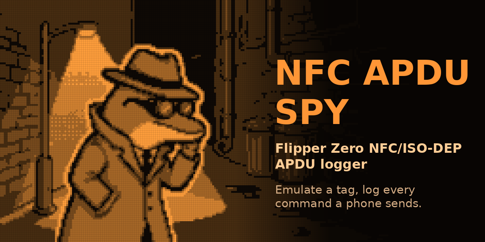
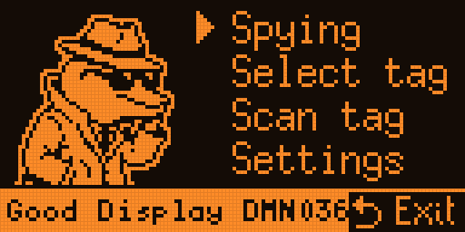
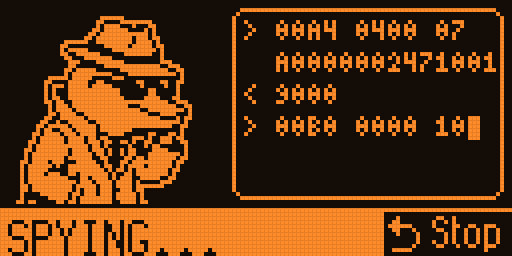
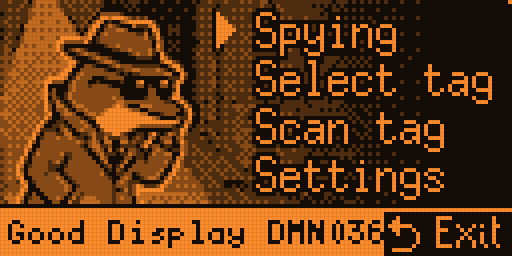
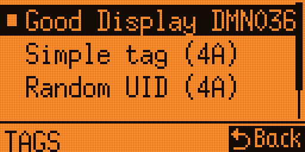
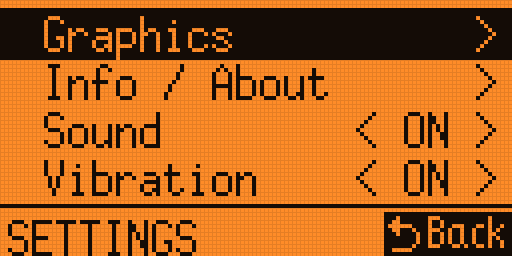
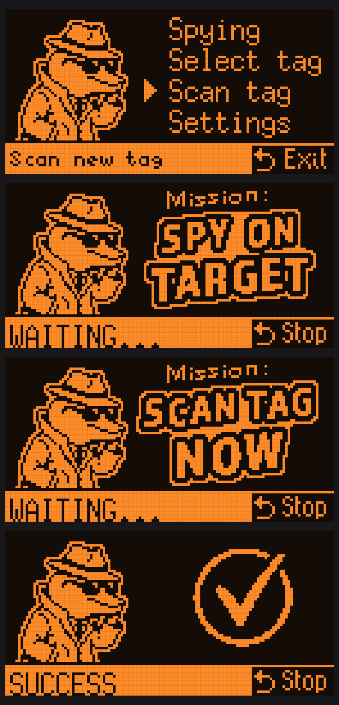

# NFC Apdu Spy



A Flipper Zero app that **pretends to be an NFC tag and logs every command (APDU) a phone or reader sends to it** — together with the answer the Flipper gives back. It's a little listening post that sits between a reader and "your" tag, so you can see the whole conversation.

> ISO14443-4A / ISO-DEP card emulation + APDU logger, for debugging your **own** NFC devices.

<p align="center">
  
  
  
  
</p>

## Why I built this

I have a **Good Display DMN036EW** e-ink badge (Spectra 6) that I wanted to bring back to life and drive myself. To do that I needed to understand **how the badge talks to the phone app** — which commands the app sends and how the badge answers each one.

There was no easy way to see that on the Flipper. So I built this: the Flipper impersonates the badge, I hold the phone to it, and the app writes down the full command/response exchange. From that log I can rebuild the badge's "answer table" and talk to it on my own terms. It turned out useful for any ISO14443-4A tag, not just my badge, so here it is.

Crucially, the spy records **both directions** — the commands the phone sends *and* the responses the emulated ("fake") Flipper tag gives back. That two-sided capture is exactly what I needed to author a new profile for my e-ink display: I had to know what the phone tells the badge, how the badge should react, and which responses the phone app accepts versus silently ignores. By tweaking the Flipper's answers and watching which ones keep the conversation alive, you can reverse-engineer a working profile step by step.

## What it does

- Emulates an **ISO14443-4A / ISO-DEP** tag (UID, ATQA, SAK, ATS from a profile).
- **Logs every APDU** the reader/phone sends, plus the Flipper's reply, live on screen.
- Saves the whole session to a timestamped log file you can review later.
- Keeps a small **library of tag profiles** (one file per device). Each profile holds the tag's identity and a table of `command → answer` lines.
- **Scan Tag**: read a real tag's identity (UID/ATQA/SAK) and save it as a new profile (you name it with the Flipper keyboard). The answers start generic — you refine them with what the log reveals.

### Two looks: 1-bit and a Gray "TEST" mode

The app ships with a normal crisp **1-bit** interface (the default). It also has an **alternative, experimental grayscale interface** built with temporal dithering — the Flipper's 1-bit screen is flashed fast enough to fake several gray shades. It's a visual test bed more than a feature; switch it on with a **long press of OK** in any screen, or under `Settings → Graphics`.

<p align="center">
  
  
  
</p>

## Screens

A typical run — start, waiting for the reader, scanning a tag, and a successful result:

<p align="center">
  
</p>

## How to use

1. **Select** a tag from the list, or **Scan** a new real tag.
2. Start **Spying** and hold the phone or reader to the Flipper.
3. It logs every command the sender sends and the reply.
4. On exit, **save the log** to review it.

Controls while spying: `Left/Right` or long `OK` toggle the graphics mode, `Back` stops (and offers to save the log). In the tag list, a **long press of OK** opens a small **Rename / Delete** menu.

## Install

This is a standard external Flipper app (FAP).

- Build with [`ufbt`](https://github.com/flipperdevices/flipperzero-ufbt): drop the folder into your apps and run `ufbt launch`, or
- Copy a prebuilt `nfc_apdu_spy.fap` to `apps/NFC/` on your Flipper's SD card.

Tested on firmware with the Momentum SDK; it uses only standard NFC, GUI, storage and notification APIs.

## Tag profile format

Profiles live in `apps_data/nfc_apdu_spy/profiles/`, one `.txt` per device:

```
# My Device Name
UID E2916F52
ATQA 0400
SAK 20
ATS 0B7833A0029090E2916F5200
# answers: <command start hex>  <answer hex>   (* = all other commands)
00A4 9000
* 6D00
```

The first `# ...` line is the name shown in the list. Edit the answer lines to make the Flipper reply like the real tag — that's how you turn a captured log into a working emulation.

## ⚠️ Disclaimer

This tool emulates contactless cards and records the data exchanged with a reader. That is powerful and could be **misused to probe or spoof systems you are not authorized to touch**.

- Use it **only on devices and systems you own or have explicit permission to test.**
- It is intended for **learning, debugging and interoperability** with your own hardware.
- Capturing, replaying or spoofing other people's cards, badges or payment devices may be **illegal** where you live and is not what this project is for.
- No warranty of any kind. **You are responsible for how you use it.**

## Credits

App by **Menrix** (alias **Don_Key_Moustache**).

## GitHub topics

Add these as repository **topics** so people can find it:

```
flipper-zero  flipperzero  flipper-zero-app  fap  flipper-application
nfc  iso14443  iso14443-4  iso-dep  apdu  rfid  smartcard
card-emulation  nfc-tag  reverse-engineering  security-tools
eink  e-paper  spectra6  good-display  embedded  c
```
