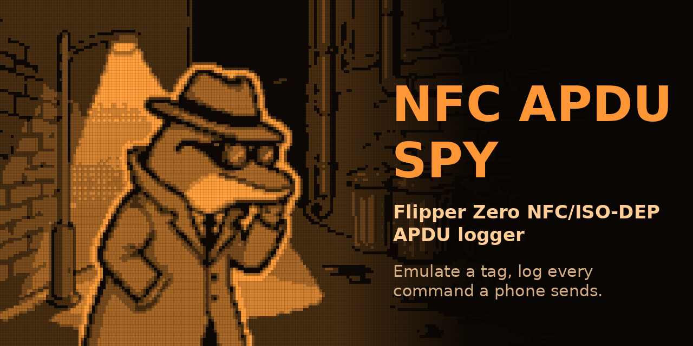
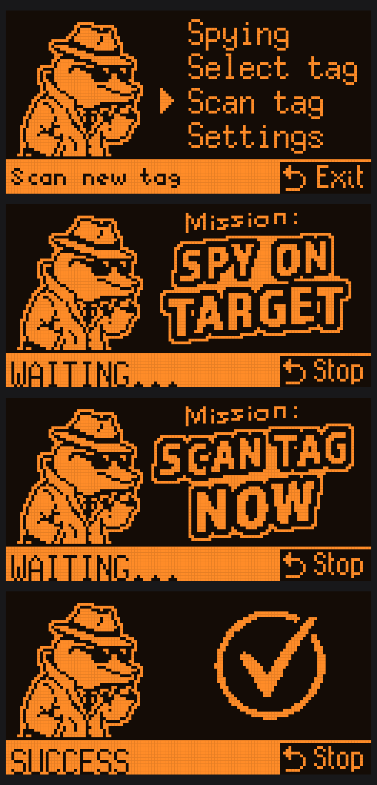
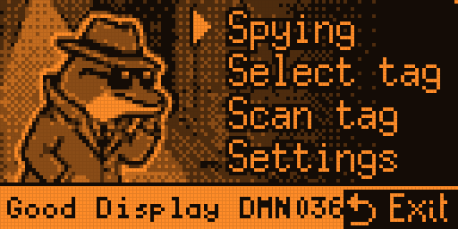
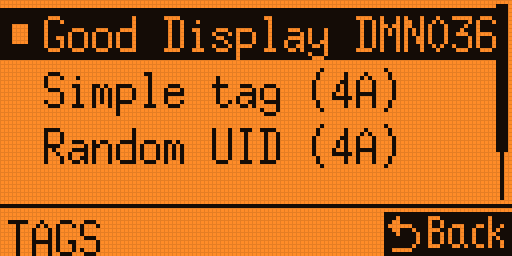
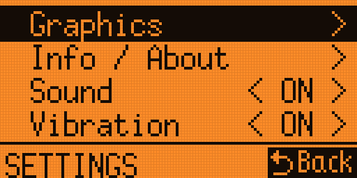

# NFC Apdu Spy

**See what your phone secretly tells an NFC tag.**

A Flipper Zero app that pretends to be an NFC tag and **logs every command (APDU)** a phone or reader sends – plus the answer the Flipper gives back. The whole conversation, both directions.

<p align="center">
  <a href="../../releases/latest"></a>
</p>



<!-- GIF here later: phone touches the Flipper → APDU lines appear live on screen -->

> ISO14443-4A / ISO-DEP card emulation + APDU logger, for debugging your **own** NFC devices.
> Works on **official** and **Momentum** firmware.

## Install

1. Download the `.fap` for your firmware (official or Momentum) from **[Releases](../../releases)**.
2. Copy it to your Flipper's SD card into `apps/NFC/` (qFlipper or the Flipper mobile app).
3. Start it under **Apps → NFC → NFC Apdu Spy**.

## How to use

<p align="center">
  
</p>

1. **Select** a tag from the list, or **Scan** a real tag.
2. Start **Spying** and hold the phone or reader to the Flipper.
3. Every command and every reply shows up live.
4. On exit, **save the log** to review it later.

| Button | Action |
|---|---|
| `Left` / `Right` or long **OK** | Toggle graphics: 1-bit ↔ Gray |
| `Back` | Stop spying (offers to save the log) |
| Long **OK** in the tag list | Rename / Delete |

## What it does

- Emulates an **ISO14443-4A / ISO-DEP** tag (UID, ATQA, SAK, ATS from a profile).
- **Logs every APDU** and the Flipper's reply, live on screen and as a timestamped log file.
- **Tag profiles:** one file per device with its identity and a `command → answer` table.
- **Scan Tag:** read a real tag's UID/ATQA/SAK and save it as a new profile.

**Why both directions matter:** change the Flipper's answers and watch which ones keep the conversation going. That way you rebuild a device's behaviour step by step.

## Why I built this

I wanted to bring my Spectra 6 e-ink badge back to life, so I had to know what the phone app tells the badge and how the badge answers. This app showed me. It works for any ISO14443-4A tag, so here it is :)

## Tag profile format

Profiles live in `apps_data/nfc_apdu_spy/profiles/`, one `.txt` per device:

```
# My Device Name
UID E2916F52
ATQA 0400
SAK 20
ATS 0B7833A0029090E2916F5200
# answers: <command start hex>  <answer hex>   (* = all other commands)
00A4 9000
* 6D00
```

The first `# ...` line is the name in the list. Edit the answer lines to make the Flipper reply like the real tag.

## Two looks: 1-bit and Gray "TEST" mode

Default is a crisp **1-bit** interface. There is also an **experimental grayscale** interface (temporal dithering: the 1-bit screen flickers fast enough to fake gray shades). Switch with a **long press of OK** or under `Settings → Graphics`.

<p align="center">
  
  
  
</p>

## ⚠️ Disclaimer

This tool emulates contactless cards and records what a reader sends. Use it **only on devices and systems you own or are allowed to test** – for learning, debugging and interoperability with your own hardware. Capturing, replaying or spoofing other people's cards, badges or payment devices may be **illegal** where you live. No warranty. **You are responsible for how you use it.**

## Credits

App by **Menrix** (alias **Don_Key_Moustache**).
